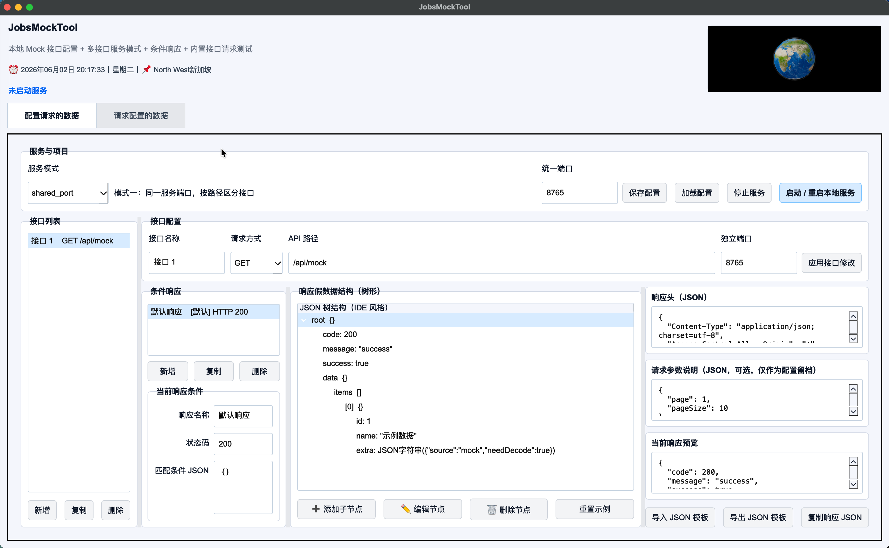
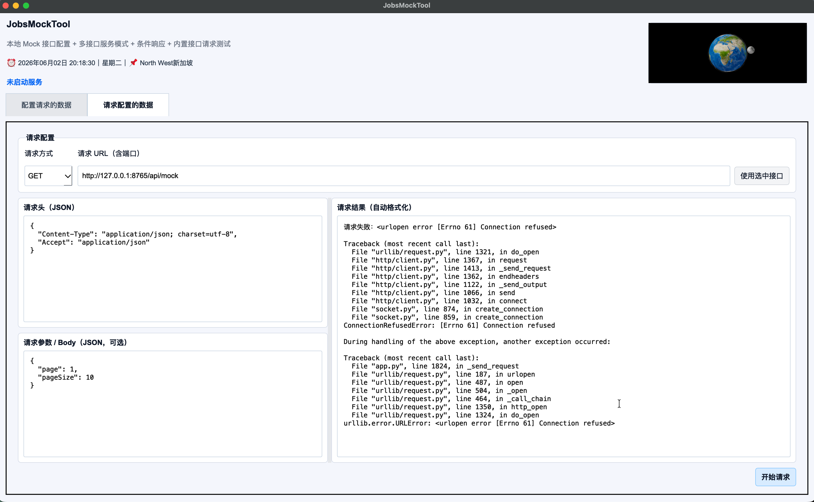

# `JobsMockTool`


<!-- jobs-toc:start -->
<!-- jobs-toc:source {"v":2,"token":"[toc]"} -->
<details>
<summary>📚 目录（点击展开 / 收起）</summary>

- [🔥 前言](#jobs-toc-heading-1)
- [一、项目目标](#jobs-toc-heading-2)
  - [1.1、核心目的](#jobs-toc-heading-3)
  - [1.2、解决的问题](#jobs-toc-heading-4)
- [二、功能总览](#jobs-toc-heading-5)
  - [2.1、基础功能](#jobs-toc-heading-6)
  - [2.2、多接口、响应与界面功能](#jobs-toc-heading-7)
- [三、界面结构](#jobs-toc-heading-8)
  - [3.1、顶部区域](#jobs-toc-heading-9)
  - [3.2、配置请求的数据](#jobs-toc-heading-10)
  - [3.3、请求配置的数据](#jobs-toc-heading-11)
  - [3.4、窗口缩放与自适应](#jobs-toc-heading-12)
- [四、Mock 数据结构设计](#jobs-toc-heading-13)
  - [4.1、为什么用树形结构](#jobs-toc-heading-14)
  - [4.2、支持的数据类型](#jobs-toc-heading-15)
  - [4.3、对象字符串说明](#jobs-toc-heading-16)
- [五、服务模式](#jobs-toc-heading-17)
  - [5.1、模式一：同一端口，按路径区分接口](#jobs-toc-heading-18)
  - [5.2、模式二：每个接口独立端口](#jobs-toc-heading-19)
- [六、条件响应](#jobs-toc-heading-20)
  - [6.1、默认响应](#jobs-toc-heading-21)
  - [6.2、按普通参数匹配](#jobs-toc-heading-22)
  - [6.3、按 query 匹配](#jobs-toc-heading-23)
  - [6.4、按 body 匹配](#jobs-toc-heading-24)
  - [6.5、按 headers 匹配](#jobs-toc-heading-25)
  - [6.6、状态码配置](#jobs-toc-heading-26)
- [七、保存 / 加载 / 导入 / 导出](#jobs-toc-heading-27)
  - [7.1、保存完整配置](#jobs-toc-heading-28)
  - [7.2、加载完整配置](#jobs-toc-heading-29)
  - [7.3、导入 JSON 模板](#jobs-toc-heading-30)
  - [7.4、导出 JSON 模板](#jobs-toc-heading-31)
- [八、运行源码](#jobs-toc-heading-32)
  - [8.1、安装依赖](#jobs-toc-heading-33)
  - [8.2、启动程序](#jobs-toc-heading-34)
- [九、macOS 打包与安装](#jobs-toc-heading-35)
  - [9.1、打包命令](#jobs-toc-heading-36)
  - [9.2、安装方式](#jobs-toc-heading-37)
  - [9.3、首次打开被拦截](#jobs-toc-heading-38)
  - [【MacOS】📦生成dmg.command](#jobs-toc-heading-39)
  - [build\_macos.command](#jobs-toc-heading-40)
- [十、Windows 打包](#jobs-toc-heading-41)
  - [10.1、打包命令](#jobs-toc-heading-42)
  - [10.2、为什么不是单文件 exe](#jobs-toc-heading-43)
  - [【Windows】📦生成exe.bat](#jobs-toc-heading-44)
  - [build\_windows.bat](#jobs-toc-heading-45)
- [十一、依赖说明](#jobs-toc-heading-46)
- [十二、常见问题](#jobs-toc-heading-47)
  - [12.1、顶部 3D 地球不显示](#jobs-toc-heading-48)
  - [12.2、端口启动失败](#jobs-toc-heading-49)
  - [12.3、接口返回 404](#jobs-toc-heading-50)
  - [12.4、接口返回 405](#jobs-toc-heading-51)
  - [12.5、条件响应没有命中](#jobs-toc-heading-52)
- [十三、风险说明](#jobs-toc-heading-53)
- [十四、项目结构](#jobs-toc-heading-54)
- [十五、未执行声明](#jobs-toc-heading-55)
- [十六、Mac Python 环境自检](#jobs-toc-heading-56)
- [十七、本仓目录与脚本入口](#repository-layout-and-entrypoints)

</details>
<!-- jobs-toc:end -->

---

## <span id="jobs-toc-heading-1" data-jobs-toc="v2">🔥 <font id=前言>前言</font></span><!-- jobs-toc:heading-end -->

**最低支持系统：[Windows](https://www.microsoft.com/windows) 10 64 位（x64）。** 这是当前最低支持目标；具体最低 build 尚未锁定，完整实机兼容性仍待验证。

`JobsMockTool` 是一个基于 [**Python**](https://www.python.org) + [**PySide6**](https://doc.qt.io/qtforpython-6/) 的本地 Mock API 桌面工具。

[**Windows**](https://www.microsoft.com/windows) **兼容范围：当前构建与成品测试目标为 Windows 10 / 11 x64；Windows XP、Vista、7、8、8.1 不支持当前图形依赖。** [**Qt 6.8 官方 Windows 平台表**](https://doc.qt.io/qt-6.8/windows.html)列出的 x64 基线为 Windows 10 1809+ / Windows 11；本项目未锁定具体运行库版本，不能据此承诺每次构建都兼容同一最低系统版本。

成品已包含 [**Python**](https://www.python.org) 与图形依赖，运行成品无需另外安装 Python；源码运行和打包才需要开发依赖。EXE 架构随构建所用 Python 和依赖 wheel 决定，x86 / ARM64 尚无统一交付验收；Windows 原生界面与分发仍须在对应目标机验证。

工程可以整体复制或改名；[构建配置](./JobsMockTool.spec) 按自身目录定位 `app.py` 与 `icon.png`。图标随 App 打包，运行时读取包内资源，分享成品不依赖开发机源码路径；目标 Mac 的系统、架构及实际启动仍须分别验证。

两端构建器生成的临时 PyInstaller 配置放在 `build/pyinstaller-spec/`，不会覆盖随源码维护的 `.spec` 配置。

[依赖配置](./requirements.txt)要求 `PySide6>=6.7`、`PyInstaller>=6.0`；构建脚本使用 PATH 中的 Python，未声明固定最低 Python 版本，实际还受所选依赖约束。Windows 包含 [**Qt WebEngine**](https://doc.qt.io/qt-6/qtwebengine-index.html)，采用 `onedir` 分发，必须保留完整目录，不能只拷 EXE。

它面向前端、客户端和脚本的本地联调：配置接口、请求条件和假数据后，启动本机服务，调用方即可通过 HTTP 获取配置的响应。

| 功能 | 当前行为 |
| --- | --- |
| 接口配置 | 配置 HTTP 方法、API 路径、端口、响应头和参数说明；一个项目维护多个接口。 |
| 服务模式 | 同一端口按路径区分接口，或每个接口使用独立端口；按钮负责启动 / 重启服务。 |
| 条件响应 | 按 query、body、headers 匹配响应分支，每个分支独立设置状态码和数据。 |
| 响应编辑 | 用树形结构编辑 JSON，支持模板导入 / 导出、实时预览和复制。 |
| 请求测试 | 内置类似 [**Postman**](https://www.postman.com/) 的请求页，查看状态码、响应头和格式化响应体。 |
| 配置保存 | 完整项目保存 / 加载为 JSON，便于重复联调和共享配置。 |
| 界面 | 顶部显示本机时间、星期与人类可读位置；右侧嵌入可拖动 3D Earth，选项卡左对齐，编辑区随窗口伸缩，最低窗口 `1600 × 960`。 |
| 分发 | macOS 生成 APP / DMG，Windows 生成 EXE；macOS 支持最小化后菜单栏驻留。 |

3D 展示使用 `https://dragonir.github.io/3d/#/earth` 远程页面；位置识别需要网络。两者只作辅助展示，网络不可用时仍可使用本地 Mock 服务。具体接口、数据类型、条件示例、运行和打包入口见下文章节。

---

## <span id="jobs-toc-heading-2" data-jobs-toc="v2">一、项目目标 <a href="#前言" style="font-size:17px; color:green;"><b>🔼</b></a> <a href="#🔚" style="font-size:17px; color:green;"><b>🔽</b></a></span><!-- jobs-toc:heading-end -->

### <span id="jobs-toc-heading-3" data-jobs-toc="v2">1.1、核心目的 <a href="#前言" style="font-size:17px; color:green;"><b>🔼</b></a> <a href="#🔚" style="font-size:17px; color:green;"><b>🔽</b></a></span><!-- jobs-toc:heading-end -->

这个程序用于在本机启动一个可配置的 Mock Server，让当前机器临时变成一台“自己的接口服务器”。

典型流程：

1、打开 `JobsMockTool`。
2、在 `配置请求的数据` 选项卡里配置接口。
3、配置 HTTP 方法、API 路径、端口、响应头、参数说明、响应数据。
4、点击 `启动 / 重启本地服务`。
5、在前端、客户端、浏览器、脚本或内置请求测试页里请求本机接口。
6、接口返回你配置好的假数据。

示例：

```text
GET http://127.0.0.1:8765/api/users
```

### <span id="jobs-toc-heading-4" data-jobs-toc="v2">1.2、解决的问题 <a href="#前言" style="font-size:17px; color:green;"><b>🔼</b></a> <a href="#🔚" style="font-size:17px; color:green;"><b>🔽</b></a></span><!-- jobs-toc:heading-end -->

开发过程中经常遇到这些问题：

- 后端接口还没开发完，前端或客户端无法联调。
- 后端接口不稳定，影响页面、App 或脚本调试。
- 某些异常状态码、边界数据、失败数据很难让真实后端配合返回。
- 只为了测一个接口，还要额外打开 Postman、Apifox 或写临时脚本。
- 普通 JSON 文件只能静态存数据，不能像真实服务器一样按路径、方法、参数返回。

`JobsMockTool` 的目的就是把这些事收口到一个桌面程序里。

---

## <span id="jobs-toc-heading-5" data-jobs-toc="v2">二、功能总览 <a href="#前言" style="font-size:17px; color:green;"><b>🔼</b></a> <a href="#🔚" style="font-size:17px; color:green;"><b>🔽</b></a></span><!-- jobs-toc:heading-end -->





### <span id="jobs-toc-heading-6" data-jobs-toc="v2">2.1、基础功能 <a href="#前言" style="font-size:17px; color:green;"><b>🔼</b></a> <a href="#🔚" style="font-size:17px; color:green;"><b>🔽</b></a></span><!-- jobs-toc:heading-end -->

| 功能 | 说明 |
| --- | --- |
| 图形化界面 | 打开程序后直接进入桌面 GUI，不需要手写服务脚本。 |
| HTTP 方法配置 | 支持 `GET`、`POST`、`PUT`、`PATCH`、`DELETE`、`OPTIONS`、`HEAD`。 |
| API 路径配置 | 支持配置 `/api/mock`、`/api/users`、`/api/orders` 等接口路径。 |
| 请求头配置 | 使用 JSON 文本配置响应头，默认带 `Content-Type` 和 CORS 相关头。 |
| 请求参数说明 | 可记录接口需要的参数结构，方便配置留档。 |
| 假数据配置 | 使用树形结构编辑最终返回的响应数据。 |
| 本地服务启动 | 点击按钮后在本机启动 HTTP Server。 |
| 内置请求测试 | 不需要再打开 Postman，可直接在第二个选项卡里请求测试。 |
| 响应格式化 | 请求结果会自动格式化 JSON，方便人工阅读。 |
| 跨平台打包 | 支持 Windows `.exe` 和 macOS `.app` / `.dmg` 打包脚本。 |

### <span id="jobs-toc-heading-7" data-jobs-toc="v2">2.2、多接口、响应与界面功能 <a href="#前言" style="font-size:17px; color:green;"><b>🔼</b></a> <a href="#🔚" style="font-size:17px; color:green;"><b>🔽</b></a></span><!-- jobs-toc:heading-end -->

| 功能 | 说明 |
| --- | --- |
| 多接口配置 | 可在同一个项目里维护多个 Mock 接口。 |
| 双服务模式 | 支持“同一端口按路径区分接口”和“每个接口独立端口”。 |
| 状态码配置 | 每个响应条件都可以配置自己的 HTTP 状态码。 |
| 条件响应 | 可根据 query、body、headers 参数返回不同假数据。 |
| 配置保存 / 加载 | 可把整个 Mock 项目保存为 JSON 文件，下次继续加载。 |
| JSON 模板导入 | 可导入现成 JSON，自动转换为树形结构。 |
| JSON 模板导出 | 可把当前树形响应导出为 JSON 文件。 |
| 复制响应 JSON | 可一键复制当前响应 JSON。 |
| 示例配置 | 内置 `examples/sample_config_shared_port.json`。 |
| 3D 展示区 | 顶部右侧的独立区域加载可拖拽 3D Earth 页面。 |
| 顶部时间位置 | 顶部左侧使用 `⏰` 显示本机当前时间和星期，使用 `📌` 显示自动识别的省市位置，不展示经纬度。 |
| 自适应布局 | 请求页、配置页文本框和结果区随窗口尺寸变化，保留最低可用高度。 |
| 最小窗口兜底 | 主窗口设置最低宽高，防止向上压缩时外层黑框压住内部面板底部。 |
| 顶部菜单栏驻留 | macOS 点击黄色最小化按钮后隐藏主窗口并驻留系统顶部菜单栏；点击图标可恢复，菜单可退出。 |

---

## <span id="jobs-toc-heading-8" data-jobs-toc="v2">三、界面结构 <a href="#前言" style="font-size:17px; color:green;"><b>🔼</b></a> <a href="#🔚" style="font-size:17px; color:green;"><b>🔽</b></a></span><!-- jobs-toc:heading-end -->

### <span id="jobs-toc-heading-9" data-jobs-toc="v2">3.1、顶部区域 <a href="#前言" style="font-size:17px; color:green;"><b>🔼</b></a> <a href="#🔚" style="font-size:17px; color:green;"><b>🔽</b></a></span><!-- jobs-toc:heading-end -->

顶部左侧显示：

- 程序名称：`JobsMockTool`
- 工具定位说明
- `⏰ 年月日 时分秒`
- 星期
- `📌 人类可读的位置`，例如 `四川省乐山市`，不展示经纬度
- 本地 Mock 服务状态

顶部右侧显示：

- 3D Earth 可拖拽展示区
- 加载地址：`https://dragonir.github.io/3d/#/earth`

注意：该区域是远程 WebGL 页面。如果当前电脑不能联网，或者系统 WebView 禁止加载远程内容，该区域可能显示为空或加载失败；Mock Server 功能不受影响。位置识别依赖网络 IP 信息，只做辅助展示，不参与 Mock 服务逻辑。

界面细节：顶部选项卡使用自定义左对齐栏；主要文本区域由布局系统联动，随窗口尺寸调整。

### <span id="jobs-toc-heading-10" data-jobs-toc="v2">3.2、配置请求的数据 <a href="#前言" style="font-size:17px; color:green;"><b>🔼</b></a> <a href="#🔚" style="font-size:17px; color:green;"><b>🔽</b></a></span><!-- jobs-toc:heading-end -->

这个页面负责生成本地接口服务。

主要区域：

| 区域 | 说明 |
| --- | --- |
| 服务模式 | 选择单端口多路径，或多接口独立端口。 |
| 统一端口 | 在“同一服务端口”模式下使用。 |
| 接口列表 | 展示当前项目下所有接口。 |
| 接口配置 | 配置接口名称、HTTP 方法、路径、独立端口。 |
| 条件响应 | 一个接口下可以有多个响应分支。 |
| 匹配条件 | 用 JSON 配置命中条件。 |
| 状态码 | 配置该条件返回的 HTTP 状态码。 |
| 响应假数据结构 | 使用树形结构编辑最终响应数据。 |
| 请求头 | 配置接口返回时携带的响应头。 |
| 请求参数说明 | 用于记录接口参数，不参与强校验。 |
| 当前响应预览 | 实时查看树形数据生成后的 JSON。 |
| 启动服务按钮 | 启动或重启本地 Mock Server。 |

### <span id="jobs-toc-heading-11" data-jobs-toc="v2">3.3、请求配置的数据 <a href="#前言" style="font-size:17px; color:green;"><b>🔼</b></a> <a href="#🔚" style="font-size:17px; color:green;"><b>🔽</b></a></span><!-- jobs-toc:heading-end -->

这个页面负责请求接口并查看结果，定位类似轻量 Postman。

支持：

- 选择请求方式。
- 填写请求 URL。
- 配置请求头 JSON。
- 配置请求参数 / Body JSON。
- 点击 `开始请求`。
- 查看 HTTP 状态码、响应头、响应体。
- 自动格式化 JSON 响应。

对于 `GET` 请求，请求参数会拼接到 query string。

对于非 `GET` 请求，请求参数会作为 JSON Body 发送。

### <span id="jobs-toc-heading-12" data-jobs-toc="v2">3.4、窗口缩放与自适应 <a href="#前言" style="font-size:17px; color:green;"><b>🔼</b></a> <a href="#🔚" style="font-size:17px; color:green;"><b>🔽</b></a></span><!-- jobs-toc:heading-end -->

界面内部的文本框、结果区和树形结构区域采用自适应布局：

- 拖动 App 外框变大时，内部编辑区同步扩展。
- 拖动 App 外框变小时，内部区域会先压缩到最小可用高度。
- 达到最低可用高度后，窗口不再继续变小；当前最低尺寸为 `1600 × 960`，目标是保证完整功能区可见。
- 请求头、请求参数、请求结果三个区域按可用空间分配高度。
- 配置页的响应头、参数说明、响应预览也跟随窗口变化。
- `匹配条件 JSON` 输入框使用固定可用高度，当前响应条件面板保留底部安全距离，避免和外层框线重合。

---

## <span id="jobs-toc-heading-13" data-jobs-toc="v2">四、Mock 数据结构设计 <a href="#前言" style="font-size:17px; color:green;"><b>🔼</b></a> <a href="#🔚" style="font-size:17px; color:green;"><b>🔽</b></a></span><!-- jobs-toc:heading-end -->

### <span id="jobs-toc-heading-14" data-jobs-toc="v2">4.1、为什么用树形结构 <a href="#前言" style="font-size:17px; color:green;"><b>🔼</b></a> <a href="#🔚" style="font-size:17px; color:green;"><b>🔽</b></a></span><!-- jobs-toc:heading-end -->

程序里的数据容器本质只有两类：

| 类型 | 对应 JSON |
| --- | --- |
| 字典 | JSON Object |
| 数组 | JSON Array |

所以 `JobsMockTool` 使用树形结构编辑假数据：

- 原点是 `root`。
- `dict` 和 `list` 可以继续添加子节点。
- 裸数据是叶子节点，不能继续往下扩展。

### <span id="jobs-toc-heading-15" data-jobs-toc="v2">4.2、支持的数据类型 <a href="#前言" style="font-size:17px; color:green;"><b>🔼</b></a> <a href="#🔚" style="font-size:17px; color:green;"><b>🔽</b></a></span><!-- jobs-toc:heading-end -->

| 类型 | 含义 | 是否可继续添加子节点 |
| --- | --- | --- |
| `dict` | 字典 / JSON Object | 是 |
| `list` | 数组 / JSON Array | 是 |
| `string` | 字符串 | 否 |
| `number` | 数字 | 否 |
| `boolean` | 布尔值 | 否 |
| `null` | 空值 | 否 |
| `object_json_string` | 对象 JSON 字符串，调用方需要二次解码 | 否 |

### <span id="jobs-toc-heading-16" data-jobs-toc="v2">4.3、对象字符串说明 <a href="#前言" style="font-size:17px; color:green;"><b>🔼</b></a> <a href="#🔚" style="font-size:17px; color:green;"><b>🔽</b></a></span><!-- jobs-toc:heading-end -->

有些业务里“对象数据”并不直接作为 JSON Object 返回，而是作为字符串返回给调用方二次解码。

这类数据可以使用：

```text
object_json_string
```

示例值：

```json
{"source":"mock","needDecode":true}
```

最终响应里会保持为字符串，不会展开成对象。

---

## <span id="jobs-toc-heading-17" data-jobs-toc="v2">五、服务模式 <a href="#前言" style="font-size:17px; color:green;"><b>🔼</b></a> <a href="#🔚" style="font-size:17px; color:green;"><b>🔽</b></a></span><!-- jobs-toc:heading-end -->

### <span id="jobs-toc-heading-18" data-jobs-toc="v2">5.1、模式一：同一端口，按路径区分接口 <a href="#前言" style="font-size:17px; color:green;"><b>🔼</b></a> <a href="#🔚" style="font-size:17px; color:green;"><b>🔽</b></a></span><!-- jobs-toc:heading-end -->

适合大多数本地联调场景。

示例：

```text
GET  http://127.0.0.1:8765/api/users
POST http://127.0.0.1:8765/api/orders
GET  http://127.0.0.1:8765/api/profile
```

优点：

- 只启动一个端口。
- 更接近普通后端服务。
- 前端只需要配置一个 baseURL。

### <span id="jobs-toc-heading-19" data-jobs-toc="v2">5.2、模式二：每个接口独立端口 <a href="#前言" style="font-size:17px; color:green;"><b>🔼</b></a> <a href="#🔚" style="font-size:17px; color:green;"><b>🔽</b></a></span><!-- jobs-toc:heading-end -->

适合你想模拟多个服务、多个微服务、多个本地接口来源的场景。

示例：

```text
GET  http://127.0.0.1:8765/api/users
POST http://127.0.0.1:8766/api/orders
GET  http://127.0.0.1:8767/api/profile
```

优点：

- 每个接口可以单独占用端口。
- 适合模拟多个服务来源。
- 方便做服务拆分场景测试。

---

## <span id="jobs-toc-heading-20" data-jobs-toc="v2">六、条件响应 <a href="#前言" style="font-size:17px; color:green;"><b>🔼</b></a> <a href="#🔚" style="font-size:17px; color:green;"><b>🔽</b></a></span><!-- jobs-toc:heading-end -->

### <span id="jobs-toc-heading-21" data-jobs-toc="v2">6.1、默认响应 <a href="#前言" style="font-size:17px; color:green;"><b>🔼</b></a> <a href="#🔚" style="font-size:17px; color:green;"><b>🔽</b></a></span><!-- jobs-toc:heading-end -->

匹配条件为空对象时，表示默认响应：

```json
{}
```

当没有任何条件响应命中时，程序会返回默认响应。

### <span id="jobs-toc-heading-22" data-jobs-toc="v2">6.2、按普通参数匹配 <a href="#前言" style="font-size:17px; color:green;"><b>🔼</b></a> <a href="#🔚" style="font-size:17px; color:green;"><b>🔽</b></a></span><!-- jobs-toc:heading-end -->

请求参数里带 `type=vip` 时命中：

```json
{
  "type": "vip"
}
```

### <span id="jobs-toc-heading-23" data-jobs-toc="v2">6.3、按 query 匹配 <a href="#前言" style="font-size:17px; color:green;"><b>🔼</b></a> <a href="#🔚" style="font-size:17px; color:green;"><b>🔽</b></a></span><!-- jobs-toc:heading-end -->

```json
{
  "query.page": 2
}
```

### <span id="jobs-toc-heading-24" data-jobs-toc="v2">6.4、按 body 匹配 <a href="#前言" style="font-size:17px; color:green;"><b>🔼</b></a> <a href="#🔚" style="font-size:17px; color:green;"><b>🔽</b></a></span><!-- jobs-toc:heading-end -->

```json
{
  "body.count": 0
}
```

### <span id="jobs-toc-heading-25" data-jobs-toc="v2">6.5、按 headers 匹配 <a href="#前言" style="font-size:17px; color:green;"><b>🔼</b></a> <a href="#🔚" style="font-size:17px; color:green;"><b>🔽</b></a></span><!-- jobs-toc:heading-end -->

```json
{
  "headers.Authorization": "Bearer token"
}
```

### <span id="jobs-toc-heading-26" data-jobs-toc="v2">6.6、状态码配置 <a href="#前言" style="font-size:17px; color:green;"><b>🔼</b></a> <a href="#🔚" style="font-size:17px; color:green;"><b>🔽</b></a></span><!-- jobs-toc:heading-end -->

每个条件响应都可以配置自己的 HTTP 状态码。

示例：

| 场景 | 状态码 |
| --- | --- |
| 正常成功 | `200` |
| 创建成功 | `201` |
| 参数错误 | `400` |
| 未登录 | `401` |
| 无权限 | `403` |
| 服务异常 | `500` |

---

## <span id="jobs-toc-heading-27" data-jobs-toc="v2">七、保存 / 加载 / 导入 / 导出 <a href="#前言" style="font-size:17px; color:green;"><b>🔼</b></a> <a href="#🔚" style="font-size:17px; color:green;"><b>🔽</b></a></span><!-- jobs-toc:heading-end -->

### <span id="jobs-toc-heading-28" data-jobs-toc="v2">7.1、保存完整配置 <a href="#前言" style="font-size:17px; color:green;"><b>🔼</b></a> <a href="#🔚" style="font-size:17px; color:green;"><b>🔽</b></a></span><!-- jobs-toc:heading-end -->

点击 `保存配置` 后，会导出完整 Mock 项目 JSON。

包含：

- 程序名
- 版本
- 服务模式
- 统一端口
- 接口列表
- 每个接口的条件响应
- 每个响应的树形数据结构

默认文件名：

```text
jobs_mock_tool_config.json
```

### <span id="jobs-toc-heading-29" data-jobs-toc="v2">7.2、加载完整配置 <a href="#前言" style="font-size:17px; color:green;"><b>🔼</b></a> <a href="#🔚" style="font-size:17px; color:green;"><b>🔽</b></a></span><!-- jobs-toc:heading-end -->

点击 `加载配置` 后，选择之前保存的 JSON 文件即可恢复完整项目。

加载配置会停止当前服务，避免旧服务和新配置混在一起。

### <span id="jobs-toc-heading-30" data-jobs-toc="v2">7.3、导入 JSON 模板 <a href="#前言" style="font-size:17px; color:green;"><b>🔼</b></a> <a href="#🔚" style="font-size:17px; color:green;"><b>🔽</b></a></span><!-- jobs-toc:heading-end -->

如果你已经有一段 JSON 响应，可以点击 `导入 JSON 模板`。

程序会自动把 JSON 转成树形结构。

### <span id="jobs-toc-heading-31" data-jobs-toc="v2">7.4、导出 JSON 模板 <a href="#前言" style="font-size:17px; color:green;"><b>🔼</b></a> <a href="#🔚" style="font-size:17px; color:green;"><b>🔽</b></a></span><!-- jobs-toc:heading-end -->

点击 `导出 JSON 模板`，可以把当前树形响应导出成标准 JSON 文件。

---

## <span id="jobs-toc-heading-32" data-jobs-toc="v2">八、运行源码 <a href="#前言" style="font-size:17px; color:green;"><b>🔼</b></a> <a href="#🔚" style="font-size:17px; color:green;"><b>🔽</b></a></span><!-- jobs-toc:heading-end -->

### <span id="jobs-toc-heading-33" data-jobs-toc="v2">8.1、安装依赖 <a href="#前言" style="font-size:17px; color:green;"><b>🔼</b></a> <a href="#🔚" style="font-size:17px; color:green;"><b>🔽</b></a></span><!-- jobs-toc:heading-end -->

```shell
python3 -m venv .venv
source .venv/bin/activate
python -m pip install --upgrade pip
pip install -r requirements.txt
```

### <span id="jobs-toc-heading-34" data-jobs-toc="v2">8.2、启动程序 <a href="#前言" style="font-size:17px; color:green;"><b>🔼</b></a> <a href="#🔚" style="font-size:17px; color:green;"><b>🔽</b></a></span><!-- jobs-toc:heading-end -->

```shell
python app.py
```

Windows 下：

```bat
python app.py
```

---

## <span id="jobs-toc-heading-35" data-jobs-toc="v2">九、macOS 打包与安装 <a href="#前言" style="font-size:17px; color:green;"><b>🔼</b></a> <a href="#🔚" style="font-size:17px; color:green;"><b>🔽</b></a></span><!-- jobs-toc:heading-end -->

### <span id="jobs-toc-heading-36" data-jobs-toc="v2">9.1、打包命令 <a href="#前言" style="font-size:17px; color:green;"><b>🔼</b></a> <a href="#🔚" style="font-size:17px; color:green;"><b>🔽</b></a></span><!-- jobs-toc:heading-end -->

必须在 macOS 上执行。在项目目录双击 `【MacOS】📦生成dmg.command`，或从项目目录运行：

```shell
./【MacOS】📦生成dmg.command
```

入口按脚本自身位置定位 `./build_macos.command/build_macos.command`，不依赖终端当前目录；项目可以放在不同用户名、中文或含空格的目录下。整个项目目录须保持完整，不能只把外层入口拷到桌面。

旧入口若报 `run_builder:2: no such file or directory`，更新外层入口；也可直接双击 `build_macos.command` 文件夹内的同名脚本。终端直接运行内层构建器的命令为：

```shell
./build_macos.command/build_macos.command
```

产物位置：

```text
dist/YYYY.MM.DD HH-mm-ss/JobsMockTool.app
dist/YYYY.MM.DD HH-mm-ss/JobsMockTool-Installer.dmg
```

### <span id="jobs-toc-heading-37" data-jobs-toc="v2">9.2、安装方式 <a href="#前言" style="font-size:17px; color:green;"><b>🔼</b></a> <a href="#🔚" style="font-size:17px; color:green;"><b>🔽</b></a></span><!-- jobs-toc:heading-end -->

1、双击 `JobsMockTool-Installer.dmg`。
2、把 `JobsMockTool.app` 拖到 `Applications`。
3、以后从 Launchpad 或应用程序目录启动。

### <span id="jobs-toc-heading-38" data-jobs-toc="v2">9.3、首次打开被拦截 <a href="#前言" style="font-size:17px; color:green;"><b>🔼</b></a> <a href="#🔚" style="font-size:17px; color:green;"><b>🔽</b></a></span><!-- jobs-toc:heading-end -->

内部未签名版本可能被 macOS Gatekeeper 拦截。

处理方式：

1、打开 `系统设置`。
2、进入 `隐私与安全性`。
3、找到 `JobsMockTool` 被拦截提示。
4、点击 `仍要打开`。

正式分发时，需要 Apple Developer 签名和 notarization 公证。

---

### <span id="jobs-toc-heading-39" data-jobs-toc="v2">[【MacOS】📦生成dmg.command](./【MacOS】📦生成dmg.command)</span><!-- jobs-toc:heading-end -->

> **目的：** 从仓库根目录进入 JobsMockTool 的 macOS 构建流程。

* 按脚本位置找到同仓 `build_macos.command/build_macos.command`，原样转交参数。
* 由构建器展示说明并等待回车，再准备环境；清理旧产物前须输入 `YES`，其它输入取消。
* 构建成功后由构建器打开产物目录并启动 APP；构建失败则向外返回失败状态。

### <span id="jobs-toc-heading-40" data-jobs-toc="v2">[build_macos.command](./build_macos.command/build_macos.command)</span><!-- jobs-toc:heading-end -->

> **目的：** 在 macOS 本机生成 JobsMockTool APP 和拖拽安装 DMG。

* 阅读构建器内置说明并确认，准备 Homebrew、Python 和项目虚拟环境。
  * 必需依赖缺失：回车安装，任意非空输入取消；失败停止。
* 输入 `YES` 后清理本工具旧构建产物与 `dist/`，其它输入取消；继续生成包含 QtWebEngine 的 APP。
* 封装带 Applications 入口的 DMG，写入同一构建时间目录。
* 更新第一层产物快捷方式，打开目录并启动新 APP；完整日志写入系统临时目录。

## <span id="jobs-toc-heading-41" data-jobs-toc="v2">十、Windows 打包 <a href="#前言" style="font-size:17px; color:green;"><b>🔼</b></a> <a href="#🔚" style="font-size:17px; color:green;"><b>🔽</b></a></span><!-- jobs-toc:heading-end -->

### <span id="jobs-toc-heading-42" data-jobs-toc="v2">10.1、打包命令 <a href="#前言" style="font-size:17px; color:green;"><b>🔼</b></a> <a href="#🔚" style="font-size:17px; color:green;"><b>🔽</b></a></span><!-- jobs-toc:heading-end -->

必须在 Windows 上执行：

```bat
build_windows.bat
```

产物位置：

```text
dist\YYYY.MM.DD HH-mm-ss\JobsMockTool\JobsMockTool.exe
```

### <span id="jobs-toc-heading-43" data-jobs-toc="v2">10.2、为什么不是单文件 exe <a href="#前言" style="font-size:17px; color:green;"><b>🔼</b></a> <a href="#🔚" style="font-size:17px; color:green;"><b>🔽</b></a></span><!-- jobs-toc:heading-end -->

本版本集成了 Qt WebEngine，用于显示顶部 3D Earth 页面。Qt WebEngine 依赖 Chromium 相关资源，强行打成单文件 exe 容易出现运行时资源缺失。

所以 Windows 默认使用 `onedir` 模式：

```text
dist\YYYY.MM.DD HH-mm-ss\JobsMockTool\JobsMockTool.exe
```

分发时请把整个 `dist\YYYY.MM.DD HH-mm-ss\JobsMockTool` 文件夹一起发出去，不要只拷贝单独的 `JobsMockTool.exe`。

---

### <span id="jobs-toc-heading-44" data-jobs-toc="v2">[【Windows】📦生成exe.bat](./【Windows】📦生成exe.bat)</span><!-- jobs-toc:heading-end -->

> **目的：** 从仓库根目录进入 JobsMockTool 的 Windows 构建流程。

* 调用同仓 `build_windows.bat`，原样转交参数。
* 由构建器展示说明并确认，随后准备依赖、清理旧产物并生成 EXE 目录。
* 构建器打开成品目录并启动 EXE，外层返回相同退出状态。

### <span id="jobs-toc-heading-45" data-jobs-toc="v2">[build_windows.bat](./build_windows.bat)</span><!-- jobs-toc:heading-end -->

> **目的：** 在 Windows 本机生成包含 QtWebEngine 的 JobsMockTool EXE 分发目录。

* 阅读构建说明并回车，创建或复用本仓 `.venv/`。
  * 依赖缺失：回车安装 `requirements.txt`，任意非空输入取消；复检失败停止。
* 清理旧 `build/`、`dist/` 和产物快捷方式，生成带完整运行库的 EXE 目录。
* 核验 EXE、更新快捷方式，打开构建时间目录并启动程序；分发时保留整个目录。

## <span id="jobs-toc-heading-46" data-jobs-toc="v2">十一、依赖说明 <a href="#前言" style="font-size:17px; color:green;"><b>🔼</b></a> <a href="#🔚" style="font-size:17px; color:green;"><b>🔽</b></a></span><!-- jobs-toc:heading-end -->

当前依赖：

```text
PySide6>=6.7
pyinstaller>=6.0
```

说明：

| 依赖 | 用途 |
| --- | --- |
| `PySide6` | 桌面 GUI 和顶部 3D WebView。 |
| `pyinstaller` | 打包成 macOS `.app` / `.dmg` 和 Windows `.exe`。 |

相比早期 Tkinter 版本，本版本为了真正把网页 3D Earth 集成到窗口里，引入了 `PySide6` 和 Qt WebEngine。

---

## <span id="jobs-toc-heading-47" data-jobs-toc="v2">十二、常见问题 <a href="#前言" style="font-size:17px; color:green;"><b>🔼</b></a> <a href="#🔚" style="font-size:17px; color:green;"><b>🔽</b></a></span><!-- jobs-toc:heading-end -->

### <span id="jobs-toc-heading-48" data-jobs-toc="v2">12.1、顶部 3D 地球不显示 <a href="#前言" style="font-size:17px; color:green;"><b>🔼</b></a> <a href="#🔚" style="font-size:17px; color:green;"><b>🔽</b></a></span><!-- jobs-toc:heading-end -->

可能原因：

- 当前电脑不能访问互联网。
- 目标网页暂时无法访问。
- Qt WebEngine 组件没有正确安装。
- 打包时没有收集完整 `PySide6` 资源。

处理方向：

```shell
pip install -r requirements.txt
python app.py
```

如果源码运行正常，但打包后不显示，重点检查打包命令里是否包含：

```text
--collect-all PySide6
```

### <span id="jobs-toc-heading-49" data-jobs-toc="v2">12.2、端口启动失败 <a href="#前言" style="font-size:17px; color:green;"><b>🔼</b></a> <a href="#🔚" style="font-size:17px; color:green;"><b>🔽</b></a></span><!-- jobs-toc:heading-end -->

说明端口被其他程序占用了。

解决方式：

- 换一个端口。
- 关闭占用端口的程序。
- 在“每个接口独立端口”模式下检查是否有端口重复。

### <span id="jobs-toc-heading-50" data-jobs-toc="v2">12.3、接口返回 404 <a href="#前言" style="font-size:17px; color:green;"><b>🔼</b></a> <a href="#🔚" style="font-size:17px; color:green;"><b>🔽</b></a></span><!-- jobs-toc:heading-end -->

说明请求路径没有配置。

检查：

- 请求方式是否一致。
- API 路径是否一致。
- 是否已经点击 `启动 / 重启本地服务`。

### <span id="jobs-toc-heading-51" data-jobs-toc="v2">12.4、接口返回 405 <a href="#前言" style="font-size:17px; color:green;"><b>🔼</b></a> <a href="#🔚" style="font-size:17px; color:green;"><b>🔽</b></a></span><!-- jobs-toc:heading-end -->

说明路径存在，但请求方式不匹配。

例如你配置的是：

```text
POST /api/orders
```

但请求的是：

```text
GET /api/orders
```

### <span id="jobs-toc-heading-52" data-jobs-toc="v2">12.5、条件响应没有命中 <a href="#前言" style="font-size:17px; color:green;"><b>🔼</b></a> <a href="#🔚" style="font-size:17px; color:green;"><b>🔽</b></a></span><!-- jobs-toc:heading-end -->

检查匹配条件 JSON。

推荐从简单条件开始：

```json
{
  "type": "vip"
}
```

确认命中后，再改成更精确的：

```json
{
  "body.type": "vip"
}
```

---

## <span id="jobs-toc-heading-53" data-jobs-toc="v2">十三、风险说明 <a href="#前言" style="font-size:17px; color:green;"><b>🔼</b></a> <a href="#🔚" style="font-size:17px; color:green;"><b>🔽</b></a></span><!-- jobs-toc:heading-end -->

- `JobsMockTool` 只监听 `127.0.0.1`，默认只服务本机请求。
- 不要把敏感 Token、真实密码、真实用户隐私数据写进 Mock 配置文件。
- `.dmg` 内部使用版未签名，正式分发需要签名和公证。
- Windows 版集成 Qt WebEngine，产物体积会明显大于 Tkinter 版。
- 顶部 3D Earth 是远程网页内容，是否可显示取决于网络和 WebView 环境。

---

## <span id="jobs-toc-heading-54" data-jobs-toc="v2">十四、项目结构 <a href="#前言" style="font-size:17px; color:green;"><b>🔼</b></a> <a href="#🔚" style="font-size:17px; color:green;"><b>🔽</b></a></span><!-- jobs-toc:heading-end -->

```text
JobsMockTool/
├── app.py
├── requirements.txt
├── 【MacOS】📦生成dmg.command
├── build_macos.command/
│   ├── build_macos.command
│   └── README.md
├── build_windows.bat
├── README.md
└── examples/
    └── sample_config_shared_port.json
```

| 文件 | 说明 |
| --- | --- |
| `app.py` | 主程序源码。 |
| `requirements.txt` | Python 依赖。 |
| `【MacOS】📦生成dmg.command` | macOS `.app` / `.dmg` 打包入口。 |
| `build_macos.command/build_macos.command` | 内层 macOS 构建器，执行环境自检、构建和产物展示。 |
| `build_windows.bat` | Windows `.exe` 打包脚本。 |
| `README.md` | 全量说明文档。 |
| `examples/sample_config_shared_port.json` | 多接口单端口示例配置。 |

---

## <span id="jobs-toc-heading-55" data-jobs-toc="v2">十五、未执行声明 <a href="#前言" style="font-size:17px; color:green;"><b>🔼</b></a> <a href="#🔚" style="font-size:17px; color:green;"><b>🔽</b></a></span><!-- jobs-toc:heading-end -->

当前仓库可以在本机执行构建脚本，但不同系统的安装包必须在对应系统上打包：

- macOS `.app` / `.dmg` 必须在 macOS 上构建。
- Windows `.exe` 必须在 Windows 上构建。

如果在 Linux 环境里只能做源码静态检查，不能直接生成真正可运行的 macOS / Windows 安装包。

打包前会清理该应用工程的旧 `dist` 产物，清理失败则停止；成功后自动打开当前平台产物的磁盘位置并运行本次生成的 APP / EXE，结尾无需回车。失败时不启动软件；运行前的防误触确认保留。

必需依赖缺失时，直接回车联网安装；输入任意字符后回车取消整个流程。安装失败或复检仍不可用时停止，不继续清理旧产物或打包。健康依赖直接复用；可选升级和词库更新仍为回车跳过、任意字符执行。

第一层平台打包入口为 `./【MacOS】📦生成dmg.command` 和 `./【Windows】📦生成exe.bat`，分别转交现有构建器；无需先进入同名脚本文件夹。

第一层交付目录与平台打包脚本同层保存 `dist/`，以及最新 APP / DMG 的相对符号链接（Mac）或 EXE / 分发包的 `.lnk`（Windows）。双击快捷方式即可接触成品，真实文件保留在 `dist/`；成功构建自动更新入口，清理旧产物时移除对应旧入口。尚无成品时不生成无效快捷方式。

构建产物使用本机本地构建时间，格式为 `YYYY.MM.DD HH-mm-ss`（年月日时分秒），例如 `2020.06.04 12-23-21`。每次构建的 APP、DMG、EXE、ZIP 和配套文件统一保存到交付层 `./dist/YYYY.MM.DD HH-mm-ss/`，同次构建只取一次时间；第一层快捷方式指向本次时间目录，成功后打开该目录并启动其中的软件。旧产物沿用原有清理规则；历史产物缺少可靠构建时间时，不补写推测时间。

## <span id="jobs-toc-heading-56" data-jobs-toc="v2">十六、Mac Python 环境自检 <a href="#前言" style="font-size:17px; color:green;"><b>🔼</b></a> <a href="#🔚" style="font-size:17px; color:green;"><b>🔽</b></a></span><!-- jobs-toc:heading-end -->

实际使用 Python 的 Mac 入口通过脚本内部的具名函数执行环境自检，完整自检实现随该脚本携带。先阅读自述并确认，再自检 [**Homebrew**](https://brew.sh/)：已有安装执行 `brew update`，只更新自身和配方索引，不全量升级其它软件；缺少时安装并复检。安装路径精确输入 `YES` 选择系统标准目录，其它输入或回车选择用户目录；失败停止，不自动改换路线。新系统缺少 Command Line Tools 时按系统提示完成安装后重试。

[**Python**](https://www.python.org) 使用 Homebrew 配方；实际版本和标准库满足工具要求时复用，不兼容时才安装 / 升级并复检。必需修复直接回车执行，任意非空输入（含空格）、EOF 或非交互缺失环境均停止。旧虚拟环境不兼容时完整改名备份后重建，保留备份。Homebrew 安装路径选择、更新、Python 版本与健康检查均封装在实际执行脚本内部，不依赖外部环境支持库、同步脚本或父仓文件。Windows 入口保持原有平台环境流程；运行已打包成品无需准备构建环境。

## 十七、<span id="repository-layout-and-entrypoints">本仓目录与脚本入口</span> <a href="#前言" style="font-size:17px; color:green;"><b>🔼</b></a> <a href="#🔚" style="font-size:17px; color:green;"><b>🔽</b></a>

以下为当前检出的源码与维护入口；依赖环境、Git 元数据、构建缓存和生成产物略去，独立子仓仅列目录。

```text
.
├── .gitignore
├── 【MacOS】📦生成dmg.command
├── 【Windows】📦生成exe.bat
├── app.py
├── assets/
├── build_macos.command/
│   ├── build_macos.command
│   └── README.md
├── build_windows.bat
├── examples/
├── icon.png
├── JobsMockTool.spec
├── README.md
├── requirements.txt
└── scripts/
    └── artifact_shortcuts.py
```

* `app.py` 保存界面、接口配置和本地 Mock 服务；`examples/` 保存请求 / 响应配置示例，`assets/` 保存界面素材，`scripts/` 保存成品快捷方式辅助代码。

<a id="🔚" href="#前言" style="font-size:17px; color:green; font-weight:bold;">我是有底线的➤点我回到首页</a>
